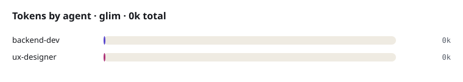

# Token usage: glim

Run: 2026-10-22T17:57:48+05:30 to 2026-10-22T18:48:10+05:30 · 2 agent runs · **0 tokens** · - of agent time

| Agent | Model | Runs | Tokens | Share | Tool uses | Agent time |
|---|---|---:|---:|---:|---:|---:|
| backend-dev |  | 1 | 0 | 0.0% | 0 | - |
| ux-designer |  | 1 | 0 | 0.0% | 0 | - |
| **Total** | | **2** | **0** | 100% | 0 | - |

Biggest consumers: backend-dev (0k), ux-designer (0k).

> Tokens are the usage each agent reported when it handed back to the Manager. The Manager's own
> (main session) tokens are not included unless the Manager logged them as `manager` runs.
