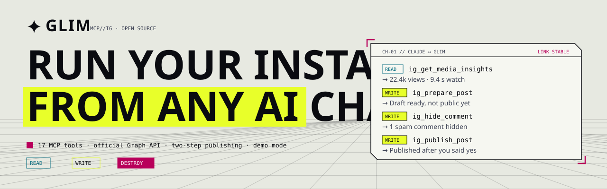
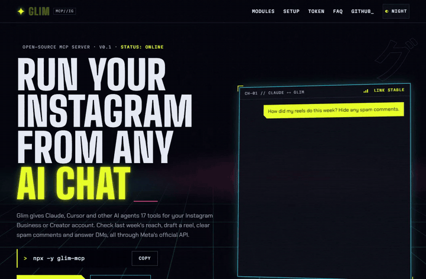
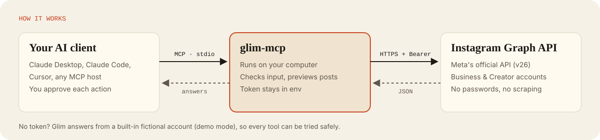
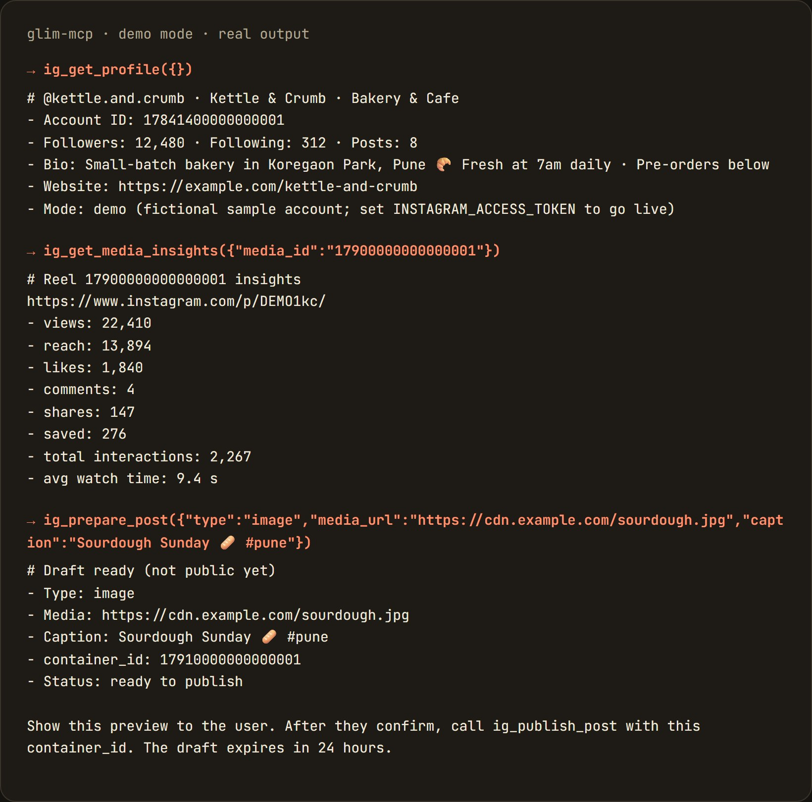
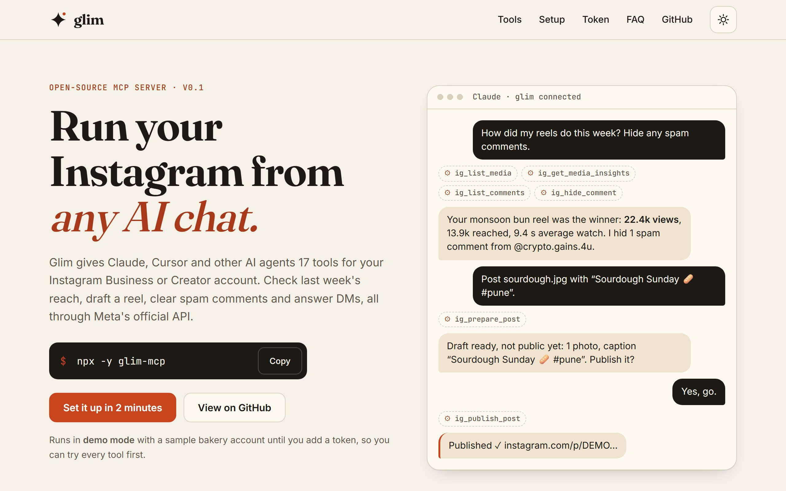
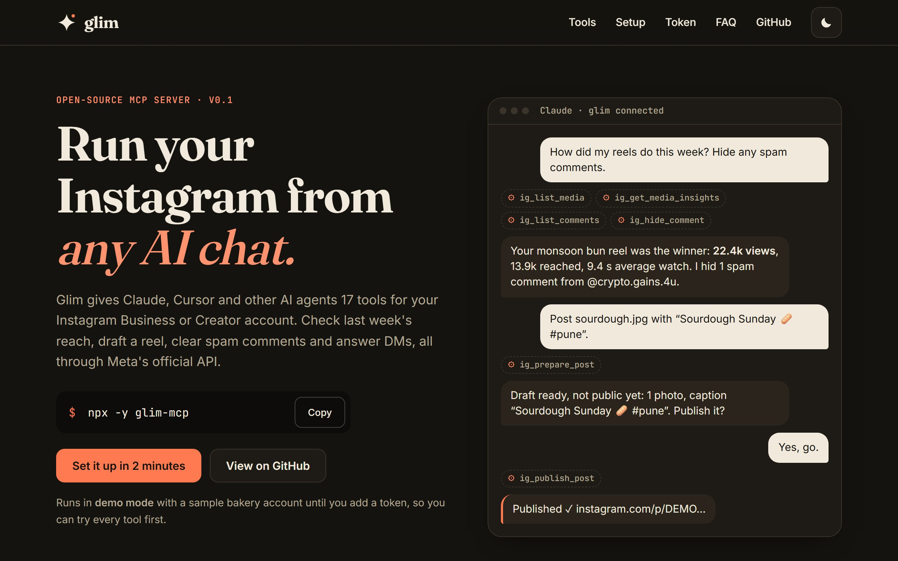
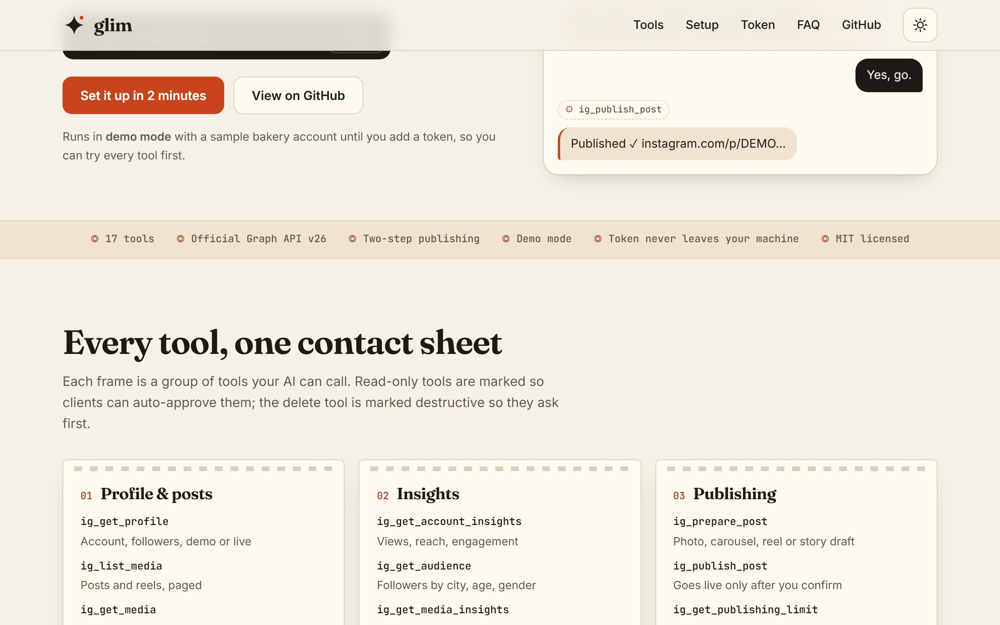
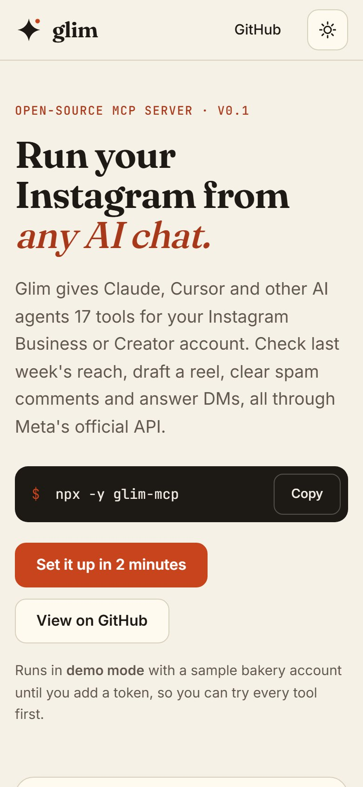

[](https://jagdish3135.github.io/knit/)

<picture>
  <source media="(prefers-color-scheme: dark)" srcset="docs/readme/banner-dark.svg">
  
</picture>

<p align="center">
  <a href="https://www.npmjs.com/package/glim-mcp"></a>
  
  
  
  
  <a href="LICENSE"></a>
</p>

<p align="center">
  <b><a href="https://glim-mcp.vercel.app">Website</a></b> ·
  <b><a href="#quick-start">Quick start</a></b> ·
  <b><a href="#tools">Tools</a></b> ·
  <b><a href="#get-an-access-token">Get a token</a></b> ·
  <b><a href="docs/readme/demo.mp4">Demo video</a></b>
</p>

**Glim** is an open-source [MCP](https://modelcontextprotocol.io) server that lets Claude, Cursor and other AI agents run an **Instagram Business or Creator account**. Ask for last week's reach, draft and publish a reel, clear spam comments or answer DMs in plain language. It only uses Meta's **official Graph API**, so there's no password sharing and no scraping.

<p align="center">
  <a href="docs/readme/demo.mp4">
    <picture>
      <source srcset="docs/readme/demo.webp" type="image/webp">
      
    </picture>
  </a>
  <br><sub>Claude checks insights, hides spam, then drafts a post and publishes it only after a "yes". <a href="docs/readme/demo.mp4">MP4</a></sub>
</p>

## Why Glim

| | |
|---|---|
| 🧾 **Nothing goes public by accident** | Publishing takes two steps. `ig_prepare_post` uploads a private draft and shows a preview, and `ig_publish_post` runs only after you confirm. |
| 🔐 **Your token stays yours** | Glim runs on your machine, reads the token from an env variable and sends it only to Meta in a request header. No tool returns it, and it's removed from error text. |
| 🧪 **Try it with no account** | Without a token, Glim answers from a built-in fictional bakery account (demo mode), so every tool works out of the box. |
| 🧭 **Errors that say what to do** | Expired token, missing permission, the 24-hour DM window, publishing quota: each error explains the fix instead of dumping a code. |
| 📏 **Checks before it calls** | Caption length, 30-hashtag and 20-mention limits, public `https://` media URLs and DM byte limits are all checked before anything reaches Instagram. |

## How it works

<picture>
  <source media="(prefers-color-scheme: dark)" srcset="docs/readme/how-it-works-dark.svg">
  
</picture>

## Quick start

Needs **Node.js 20+**. Leave out the token to start in demo mode.

<details open>
<summary><b>Claude Desktop</b></summary>

Settings → Developer → Edit Config, add this to `claude_desktop_config.json`, then restart Claude:

```json
{
  "mcpServers": {
    "glim": {
      "command": "npx",
      "args": ["-y", "glim-mcp"],
      "env": { "INSTAGRAM_ACCESS_TOKEN": "IGAA...your token..." }
    }
  }
}
```
</details>

<details>
<summary><b>Claude Code</b></summary>

```bash
claude mcp add glim -e INSTAGRAM_ACCESS_TOKEN=IGAA... -- npx -y glim-mcp
```
</details>

<details>
<summary><b>Cursor</b></summary>

Add the same JSON as Claude Desktop to `~/.cursor/mcp.json` (or `.cursor/mcp.json` in a project).
</details>

Then ask: *"Show my Instagram profile."* The first line of the answer says whether you're in demo or live mode.

## Tools

| Group | Tool | What it does |
|---|---|---|
| **Profile & posts** | `ig_get_profile` | Account, followers, bio, demo or live mode |
| | `ig_list_media` | Posts, reels and carousels, newest first, cursor paging |
| | `ig_get_media` | One post: full caption, media URL, carousel slides |
| **Insights** | `ig_get_account_insights` | Views, reach, accounts engaged, interactions, follows over 1–30 days |
| | `ig_get_audience` | Followers or engaged audience by country, city, age or gender |
| | `ig_get_media_insights` | Per post; picks the right metrics per type, reels get average watch time |
| **Publishing** | `ig_prepare_post` | Step 1: photo, carousel (2–10), reel or story as a private draft plus preview |
| | `ig_publish_post` | Step 2: publish the confirmed draft, returns the link |
| | `ig_get_publishing_limit` | Posts used out of the 24-hour API quota |
| **Comments** | `ig_list_comments` | Comments with replies, likes and hidden state |
| | `ig_reply_to_comment` | Reply under a comment, or comment on a post |
| | `ig_hide_comment` | Hide or unhide (reversible) |
| | `ig_delete_comment` | Delete; marked destructive so clients ask first |
| **Direct messages** | `ig_list_conversations` | Inbox, most recent first |
| | `ig_get_messages` | Latest 20 messages, and whether you can still reply |
| | `ig_send_message` | Text reply inside Instagram's 24-hour window |
| **Hashtags** | `ig_search_hashtag` | Top or recent public posts for a hashtag |

Read tools support `response_format: "json"` for structured output. Every tool has MCP annotations (read-only, destructive, idempotent) so clients can auto-approve reads and confirm writes.

<p align="center"><br><sub>Real tool output, demo mode</sub></p>

## Get an access token

1. Switch your Instagram account to **Professional** (Business or Creator) in the Instagram app.
2. Create an app at [developers.facebook.com/apps](https://developers.facebook.com/apps) and add **Instagram → API setup with Instagram Login**.
3. Under **Generate access tokens**, add your account and grant: `instagram_business_basic`, `instagram_business_content_publish`, `instagram_business_manage_comments`, `instagram_business_manage_messages`, `instagram_business_manage_insights`.
4. Put the long-lived token (starts with `IG`, valid 60 days) in `INSTAGRAM_ACCESS_TOKEN`.

| Variable | Needed | Meaning |
|---|---|---|
| `INSTAGRAM_ACCESS_TOKEN` | for live mode | `IG…` = Instagram Login (graph.instagram.com) · `EAA…` = Facebook Login (graph.facebook.com) |
| `INSTAGRAM_USER_ID` | sometimes | Your professional account ID; set it with Facebook Login if you have several Pages |
| `INSTAGRAM_API_VERSION` | no | Defaults to `v26.0` |

<details>
<summary><b>Meta's limits worth knowing</b></summary>

- **Hashtag search** exists only on the Facebook Login API, with the *Instagram Public Content Access* feature, for 30 unique hashtags per 7 days. With an `IG…` token the tool says so.
- **DMs** can be sent only within 24 hours of the person's last message. Managing accounts you don't own needs Advanced Access through App Review.
- **Publishing**: media must be at a public `https://` URL (Instagram downloads it); photos must be JPEG; about 100 API posts per 24 hours.
- **Insights** can lag up to 48 hours; demographics need 100+ followers. `impressions` was retired in 2025, so Glim uses `views`.
- Personal (non-professional) accounts aren't supported by Meta's API.
</details>

## Screenshots

<details>
<summary><b>Website (light, dark, phone)</b></summary>




<p align="center"></p>
</details>

## Develop

```bash
npm install
npm run build       # compile to dist/
npm test            # 43 unit and tool-flow tests (vitest)
npm run smoke       # starts the built server over stdio and calls real tools
npm run inspect     # opens the MCP Inspector against the built server
```

- `src/graph.ts`: Graph API client with token-type host detection and recovery-focused error messages
- `src/demo.ts`: in-process fake Graph API used by demo mode and the tests (same paths, same error codes)
- `src/tools/`: one file per tool group · `site/`: the landing page (static, deployed on Vercel)
- README media: `node docs/readme/make-svgs.mjs` and, with the site served on port 5190, `node docs/readme/capture.mjs`

## Disclaimer

Glim is an independent open-source project. It isn't affiliated with, endorsed by or sponsored by Meta Platforms or Instagram. *Instagram* is a trademark of Meta Platforms, Inc. Follow [Meta's Platform Terms](https://developers.facebook.com/terms/) and Instagram's community guidelines when using it.

MIT © Jagdish Patil
